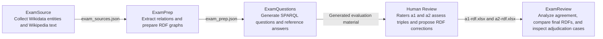

# KGTestBench

KGTestBench collects source material for knowledge-graph experiments. Given an entity name, it searches Wikidata, finds the linked Wikipedia page, and saves the page's introductory phrases together with the resolved entity metadata.

The pipeline collects source metadata, prepares RDF graphs, and generates deterministic SPARQL questions with reference answers for knowledge-graph evaluation.

## Workflow



The arrows show the workflow sequence. Human reviewers use the source text and RDF graphs to record their assessments; ExamReview analyzes those workbooks. The separate export script generates the adjudication JSON for human decisions.

## Components

- `ExamSource.py` orchestrates input loading, Wikidata resolution, and output merging. See [docs/ExamSource.md](./docs/ExamSource.md) for the script's behavior, configuration variables, input format, output schema, and examples.
- `utils/text.py` provides pure text cleaning, splitting and uniqueness helpers.
- `utils/file.py` provides reusable UTF-8 file operations.
- `utils/api.py` provides shared HTTP, retry, throttling, and JSON response handling.
- `utils/config.py` loads `.env` settings and provides runtime configuration.
- `utils/wikidata.py` handles entity searches, candidate selection, metadata and Wikipedia sitelinks.
- `utils/wikipedia.py` uses `utils/api.py` for Wikipedia-specific requests and extract retrieval.
- [ExamPrep.py](./ExamPrep.py) prepares individual and combined RDF graphs from source JSON. See [docs/ExamPrep.md](./docs/ExamPrep.md) for usage and output.
- [ExamQuestions.py](./ExamQuestions.py) generates questions, SPARQL queries and reference answers in [data/exam_questions.json](./data/exam_questions.json) from [data/exam_prep.json](./data/exam_prep.json), reading candidate metadata separately from [data/exam_sources.json](./data/exam_sources.json). Generation runs locally with RDFLib. See [docs/ExamQuestions.md](./docs/ExamQuestions.md) for query semantics, Unicode and accent normalization, usage and output.

## Requirements

- Python 3.10 or newer
- Internet access to the Wikidata and Wikipedia APIs for source collection; question generation uses local inputs
- Packages listed in [requirements.txt](./requirements.txt)

## Installation

From the KGTestBench directory, create a virtual environment and install the dependencies:

```powershell
cd KGTestBench
python -m venv .venv
.\.venv\Scripts\Activate.ps1
python -m pip install -r requirements.txt
```

Copy the configuration template:

```powershell
Copy-Item .env.example .env
```

## Human review and inter-rater reliability

[ExamReview.ipynb](./ExamReview/ExamReview.ipynb) is the unified, data-centered review: input audit, criterion and whole-triple agreement, shared-error diagnosis, final RDF comparison, and adjudication cases. It answers eight questions with tables, charts, and computed interpretations using [a1-rdf.xlsx](./data/inter-rater-reliability/a1-rdf.xlsx), [a2-rdf.xlsx](./data/inter-rater-reliability/a2-rdf.xlsx), and [disagreements.json](./data/disagreements.json). See [docs/ExamReview.md](./docs/ExamReview.md) for setup and execution.

Export unique JSON adjudication cases for unilateral approvals, differing diagnoses, competing RDF relations, and unilateral unresolved-entity markers:

```powershell
python ExamReview/export_disagreements.py
```

The output is [data/disagreements.json](./data/disagreements.json), with source evidence and adjudication fields. Existing files are protected from accidental overwrite. The [ExamReview guide](./docs/ExamReview.md) explains the code organization, metrics, current results, and next steps.

## Tests

Run the local test suite from the `KGTestBench` directory:

```powershell
python -m pip install -r requirements-review.txt
python -m unittest discover -s tests -p "test_*.py" -v
```